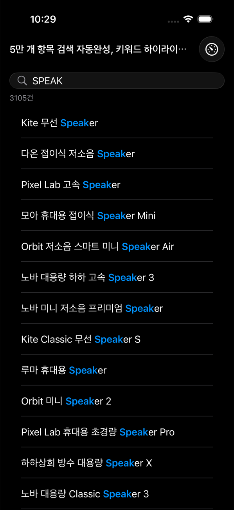
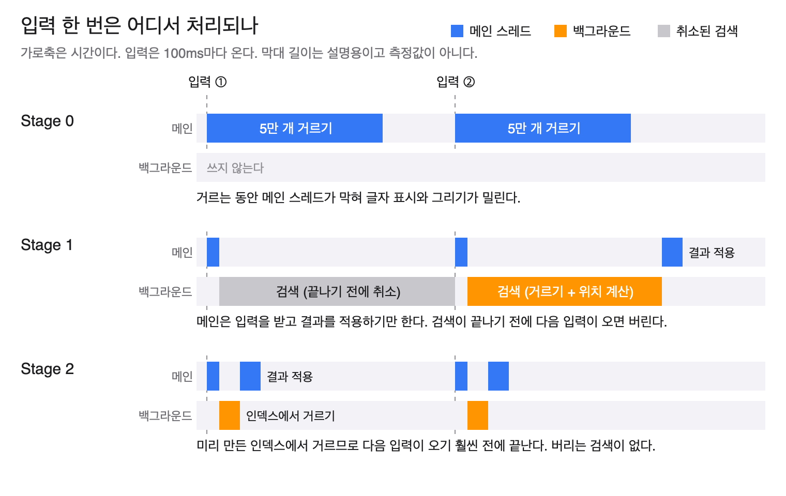
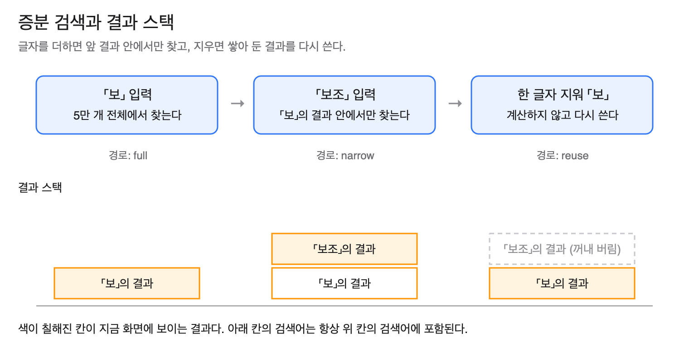
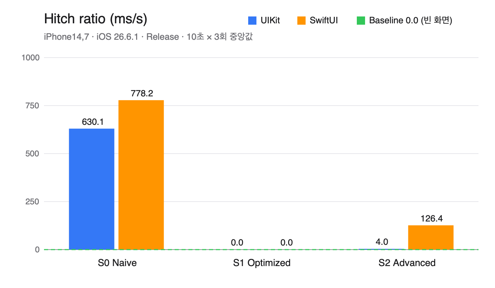
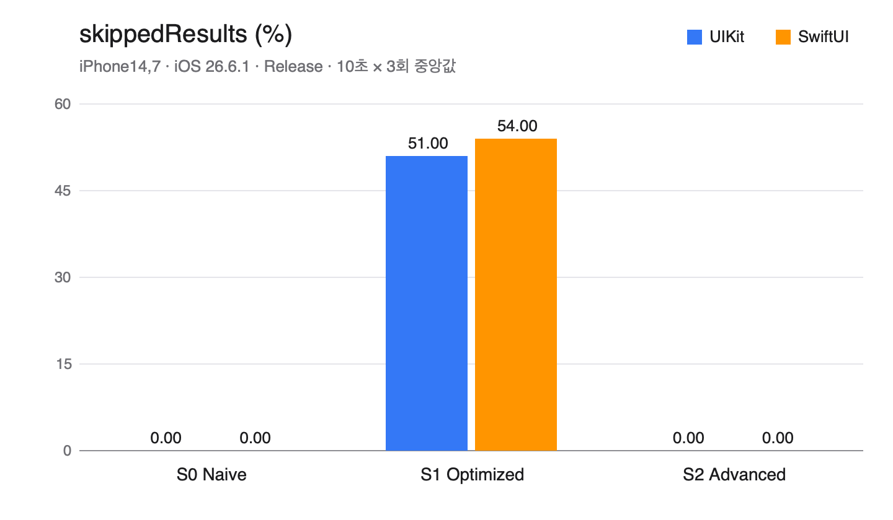

# [PerfLab #01] 5만 개 항목 검색 자동완성, 키워드 하이라이트까지 타이핑을 따라가려면?

> 검색을 백그라운드로 옮기자 화면은 부드러워졌지만 검색어의 절반(51~54%)이 결과를 보여 주지 못했다. 인덱스와 증분 검색으로 일 자체를 줄이자 버려지는 검색어가 사라졌고 CPU 사용이 절반 아래로 내려갔다.

측정 환경: iPhone 14 실기기(iOS 26.6.1, 최대 60fps), Release 빌드, 10초 × 3회 중앙값. 수치는 UIKit / SwiftUI 순서다.

## 상황

쇼핑 앱의 검색 화면이다. 상품 5만 개를 기기 안에 들고 있고, 글자를 입력할 때마다 결과 목록이 바로 바뀐다. 각 행에서는 검색어와 일치한 부분을 굵게 강조한다.



실제 앱 화면이다 (시뮬레이터, Stage 2 UIKit). 대소문자를 구분하지 않고, 이름 어디에 있든 찾는다.

입력은 빠르다. 측정에서는 100ms마다 한 글자를 넣거나 지웠다. 한 글자마다 5만 개를 다시 거르고, 보이는 행의 강조 위치를 찾아야 한다.

## 문제 정의

가장 단순하게 만들면 글자가 늦게 찍힌다. 입력을 받는 일과 5만 개를 거르는 일이 같은 메인 스레드에서 일어나기 때문이다.

**주문도 받고 음료도 만드는 1인 카페**를 떠올리면 쉽다. 직원이 음료를 만드는 동안에는 다음 손님의 주문을 받지 못한다. 줄이 멈춘다.
메인 스레드가 그 직원이다. 터치를 받고, 글자를 표시하고, 화면을 그리는 일을 혼자 한다. 여기에 5만 개 거르기를 얹으면 그동안 나머지가 모두 멈춘다.

- 비유가 어긋나는 지점: 사람은 음료를 만들면서도 손님 말을 들을 수 있다. 메인 스레드는 하던 일이 끝날 때까지 다른 일을 전혀 하지 못한다.

Stage 0에서 거르기 한 번은 64.7 / 69.6ms였다. 화면은 16.7ms마다 새로 그려져야 하는데 그 네 배를 메인 스레드가 붙잡고 있는 셈이다.
그 결과 1초 중 프레임이 밀린 시간(hitch ratio)이 630.1 / 778.2ms였다. Apple은 10ms/s 이상을 심각한 수준으로 본다.

## 단계별 구현



세 Stage의 차이는 "거르는 일을 어디서, 얼마나 오래 하는가"다.

### Stage 0 · Naive

입력마다 메인 스레드에서 전체를 거른다.

```swift
products.filter { $0.name.lowercased().contains(query.lowercased()) }
```

한 줄이지만 입력 한 번에 이름 5만 개를 하나씩 `lowercased()`로 바꿔 새 문자열을 만든다 (검색어의 `lowercased()`도 그만큼 되풀이된다). 상품 이름은 바뀌지 않는데 같은 변환을 입력마다 다시 한다.

### Stage 1 · Optimized

Stage 0의 거르는 코드를 그대로 백그라운드 `Task`로 옮기고, 새 입력이 오면 진행 중인 검색을 취소한다. 강조 위치도 여기서 결과 전체에 대해 미리 구한다.

카페로 치면 **음료를 만드는 직원을 따로 둔 것**이다. 주문 받는 줄은 더 이상 멈추지 않는다. 하지만 음료 한 잔을 만드는 시간은 줄지 않는다. 그리고 손님이 주문을 바꾸면 만들던 음료는 버린다.

```swift
if let searchTask {
    // 앞 검색어의 결과는 이제 화면에 나오지 못한다.
    searchTask.cancel()
    context.metrics.record("skippedResults", value: 100, unit: "%")
}
searchTask = Task {
    guard let output = try? await search.search(query) else { return }
    // ...
    guard !Task.isCancelled else { return }
    apply(output, inputTime: inputTime)
}
```

- 비유가 어긋나는 지점: 실제 취소는 누가 음료를 빼앗아 버리는 것이 아니다. `cancel()`은 표시만 남기고, 계산하는 쪽이 `Task.checkCancellation()`으로 스스로 확인하고 멈춘다. 확인하지 않으면 쓸모없어진 계산을 끝까지 한다.
- 늦게 끝난 옛 결과가 새 결과를 덮지 않는 이유: 취소(`submit`)와 "취소됐는지 확인하고 적용"하는 코드가 모두 메인 액터에서 차례로 실행된다. 둘 사이에 끼어들 틈이 없어서 버전 번호나 락이 필요 없다.

### Stage 2 · Advanced

Stage 1은 일을 옮겼을 뿐 줄이지 않았다. Stage 2는 일 자체를 줄인다. 근거가 된 비용은 두 가지다.

**1. 같은 변환을 되풀이하는 비용 → 인덱스.** 화면을 열 때 이름 5만 개를 소문자 UTF-16 숫자 배열로 한 번만 바꿔 둔다. 검색은 숫자 배열끼리 비교하는 일만 남는다.

```swift
while start <= name.count - query.count {
    // 첫 코드 단위가 다르면 나머지는 비교하지 않는다.
    if name[start] == first, name[start..<start + query.count].elementsEqual(query) {
        return start
    }
    start += 1
}
```

**2. 매번 5만 개를 다 보는 비용 → 증분 검색.** "보조"를 포함하는 이름은 반드시 "보"도 포함한다.

**서류 더미**에 비유하면 이렇다. "보"가 들어간 서류를 한 번 추려 더미로 쌓아 두면, "보조"는 5만 장이 아니라 그 더미에서만 다시 추리면 된다. 글자를 지워 "보"로 돌아가면 아까 쌓아 둔 더미를 그대로 꺼낸다.



글자를 더하면 앞 결과 안에서만 찾고, 지우면 쌓아 둔 결과를 다시 쓴다 (경로 이름 full, narrow, reuse는 코드의 `Stage2ResultStack.Plan`과 같다).

- 비유가 어긋나는 지점: 더미를 계속 쌓아 두지는 않는다. 글자를 지우면 위에 있던 더미는 버리므로, 같은 글자를 다시 치면 새로 추린다. 그리고 화면에 실제로 적용된 결과만 쌓인다.
- 대가: 더미를 쌓아 둘 책상이 필요하다. 그 책상이 메모리다.

강조 위치도 결과 전체가 아니라 화면에 보이는 행만 구한다. UIKit에서는 UTF-16 배열의 위치가 곧 `NSRange`의 위치라서 변환 없이 바로 쓴다 (SwiftUI의 `AttributedString`은 자기 인덱스로 한 번 더 바꿔야 한다).

## 측정 결과



Stage 1에서 끊김이 사라진다. Stage 2는 UIKit에서는 거의 없고 SwiftUI에는 다시 생겼다.

| 지표 | S0 | S1 | S2 |
|---|---:|---:|---:|
| 입력이 화면에 반영되기까지 `inputDelay` (ms) | 83.8 / 159.6 | 33.2 / 32.6 | 35.5 / 46.5 |
| 검색 한 번 `filterTime` (ms) | 64.7 / 69.6 | 65.0 / 64.4 | 1.82 / 0.87 |
| CPU 평균 (%) | 70.5 / 89.2 | 85.3 / 87.3 | 31.0 / 36.9 |
| 검색용 자료구조 `searchMemory` (MB) | 0.21 / 0.22 | 0.14 / 0.14 | 3.89 / 3.89 |
| Memory peak (MB) | 38.2 / 47.3 | 34.8 / 36.5 | 41.3 / 51.9 |

Hitch ratio와 `skippedResults`는 차트로 따로 보인다. 전체 지표와 회차별 값은 [RESULTS.md](RESULTS.md)에 있다.

**Stage 1은 부드럽지만 절반을 버린다.**



Stage 1에서 입력한 검색어의 51 / 54%는 결과를 한 번도 화면에 보여 주지 못했다. 검색이 끝나기 전에 다음 글자가 들어와 취소됐기 때문이다. 화면은 60fps로 매끄럽지만, 사용자가 보는 결과는 입력을 절반밖에 따라가지 못한다. CPU도 줄지 않았다.

**Stage 1의 평균을 그대로 믿으면 안 된다.** 표에서 Stage 1의 `filterTime`은 Stage 0과 같고, `searchMemory`는 오히려 Stage 0보다 작다. Stage 1은 Stage 0의 결과에 강조 위치까지 더 들고 있으므로, 같은 검색어라면 더 작을 수 없다.

**완주자의 기록만으로 낸 마라톤 평균**과 같은 일이 생긴 것이다. `filterTime`은 계산을 끝까지 마친 검색만, `searchMemory`는 화면에 적용된 검색만 기록한다. 도중에 취소된 검색은 어느 평균에도 들어가지 않는다. 그리고 오래 걸리는 검색, 결과가 큰 검색일수록 취소되기 쉽다.

- 비유가 어긋나는 지점: 마라톤에서는 중도 포기자가 꼭 느린 사람은 아니다. 여기서는 구조상 느린 검색부터 탈락한다. 그래서 평균이 한쪽으로만 기운다.
- Stage 1의 대가로 확실히 말할 수 있는 것은 `skippedResults`와 CPU다.

**Stage 2는 일이 줄었다.** 검색 한 번이 1.82 / 0.87ms가 됐고 CPU가 31.0 / 36.9%로 내려갔다. 버려지는 검색어가 없다. 다만 이 평균에는 글자를 지울 때 계산 없이 결과를 다시 쓴 경우가 섞여 있어서, "65ms가 1.8ms가 됐으니 36배 빠르다"고 읽으면 과장이다.

대가는 메모리다. 인덱스와 결과 스택이 3.89MB이고, 앱 전체 Memory peak는 Stage 0보다 3.1 / 4.6MB 늘었다.

**SwiftUI의 Stage 2에는 끊김이 남았다** (126.4ms/s). 검색 로직은 UIKit과 같으므로 원인은 결과를 목록에 적용하는 쪽에 있다고 본다. 검색이 빨라져 모든 결과가 화면에 적용되자, 그 뒤에 있던 다음 병목이 드러난 것으로 보인다. Instruments로 확인하지 않은 가설이다.

## 필요한 CS 지식

- **메인 스레드와 프레임 예산 (Stage 0).** 화면은 60Hz 기준 16.7ms마다 새로 그려진다. 메인 스레드는 그 안에 입력 처리와 화면 갱신을 끝내야 하고, 못 끝내면 프레임이 밀린다(hitch).
- **협력적 취소 (Stage 1).** 취소는 강제 종료가 아니라 표시이고, 작업이 스스로 확인해야 멈춘다.
- **액터의 직렬 실행 (Stage 1).** 메인 액터는 한 번에 한 작업만 실행하므로, "취소"와 "확인 후 적용"이 서로 끼어들지 못한다.
- **전처리 인덱스 (Stage 2).** 바뀌지 않는 데이터에 대한 반복 계산은 한 번만 해 두고 결과를 들고 있는다. 시간을 메모리와 준비 시간으로 바꾸는 거래다.
- **검색 공간 줄이기 (Stage 2).** 답이 있을 수 있는 범위를 먼저 좁히고 그 안에서만 찾는다. 여기서는 검색어 사이의 포함 관계가 범위를 알려 준다.
- **문자열 표현 (Stage 2).** Swift `String`은 글자 단위라 정수로 바로 접근하지 못하고, UIKit의 `NSRange`는 UTF-16 단위를 센다. 미리 UTF-16 배열로 바꿔 두면 비교가 빠르고, UIKit에서는 위치 변환도 필요 없다.
- **생존 편향 (측정).** 취소가 있는 구조에서는 평균에 들어가는 표본이 "끝까지 살아남은 작업"으로 바뀐다. 평균을 볼 때는 무엇이 빠졌는지를 함께 본다.

## 예측과 실제

| 예측 | 실제 | 배운 것 |
|---|---|---|
| "글자가 늦게 찍힌다. 갱신이 늦는다. 검색와 후보 리스트 싱크가 순간적으로 안 맞는다" | Stage 0에서 `inputDelay` 83.8 / 159.6ms | 세 증상은 원인이 다르다. 글자가 늦는 것은 메인 스레드, 갱신이 늦는 것은 계산량, 싱크가 어긋나는 것은 백그라운드 결과의 순서 문제다 |
| 백그라운드로 옮기면 결과가 뜨는 시간(`resultLatency`)도 줄어들 것 | 65.1 → 65.3ms / 73.3 → 64.7ms. 다만 화면에 적용된 검색만의 평균이고, 검색어의 51 / 54%는 결과가 아예 나오지 못했다 | 일을 다른 스레드로 옮기면 기다리는 주체가 바뀔 뿐, 일의 양은 줄지 않는다. 살아남은 것만의 평균으로는 줄었다고도 늘었다고도 말할 수 없다 |
| Stage 1에서 버려지는 검색어는 실기기에서 더 많아질 것 ("실기기가 더 빠르게 반응해서") | 51 / 54%. 예측의 기준이던 사흘 전 시뮬레이터 값은 UIKit 13%였는데, 같은 날 다시 잰 시뮬레이터는 54 / 57%였다 (iPhone 17 Pro 시뮬레이터, iOS 26.5 → 26.1 런타임, 참고용) | 빨라서 버려지는 것이 아니라, 다음 입력이 오기 전에 끝나지 못해서 버려진다. 시뮬레이터는 두 번 잰 값이 크게 달라 비교 기준이 되지 못했다 (원인은 확인하지 않았다). 처음 값만 봤다면 손실을 13%로 결론 냈을 것이다 |
| Stage 2의 끊김은 실기기에서도 비슷하게 나올 것 | UIKit은 거의 없고(4.0ms/s) SwiftUI에만 남았다(126.4ms/s) | 원인은 확인하지 못했다. 검색 로직이 같으므로 결과를 화면에 적용하는 쪽을 의심하고 있다 |

코드를 따로 검증하면서 틀린 주석과 측정 코드도 나와 고친 뒤 다시 측정했다 ([VERIFICATION.md](VERIFICATION.md)).

## 트레이드오프 & 회고

| | 얻는 것 | 치르는 것 |
|---|---|---|
| Stage 1 | 화면이 끊기지 않는다. 코드 변화가 작다 | 일의 양은 줄지 않는다. 검색이 입력 간격 안에 끝나지 못하면 결과가 입력을 따라가지 못한다 |
| Stage 2 | 일이 줄어 결과가 바로 뜬다. CPU가 절반 이하다 | 메모리 약 4MB, 화면을 열 때 인덱스 생성 49.2 / 41.5ms, 검색 타입이 1개에서 3개로 늘어난 복잡도 |

- **Stage 1은 어디에나 먼저 적용한다.** 메인 스레드를 막지 않는 것은 선택이 아니다. 다만 "부드러워졌다"에서 멈추지 말고, 결과가 입력을 따라가는지를 따로 재야 한다.
- **Stage 2는 데이터가 기기 안에 있고 자주 바뀌지 않을 때 적용한다.** 5만 개 규모에서 4MB는 싼 값이다. 데이터가 자주 바뀌거나 훨씬 크다면 인덱스를 디스크에 두거나 서버가 검색하는 편이 낫다.
- **증분 검색의 이득은 입력 패턴에 달려 있다.** 글자를 이어 치거나 지울 때만 앞 결과를 쓸 수 있다. 매번 새 단어를 치면 전체를 다시 훑는다.
- **남은 것:** SwiftUI Stage 2의 끊김 원인을 Instruments로 확인하지 못했다. 120Hz 기기에서는 측정하지 않았다. 이름 어디든 찾는 검색을 더 줄이려면 n-gram 역색인 같은 구조가 다음 후보다.

## 참고 자료

- [PLAN.md](PLAN.md): 시나리오, 지표 정의, Stage 전략과 대가
- [RESULTS.md](RESULTS.md): 전체 측정 결과와 분석
- [LEARNING.md](LEARNING.md): 단계마다의 예측과 문답
- [VERIFICATION.md](VERIFICATION.md): 코드와 글의 검증 기록
- Apple, [Task](https://developer.apple.com/documentation/swift/task): 취소와 `Task.checkCancellation()`
- Apple, [String.UTF16View](https://developer.apple.com/documentation/swift/string/utf16view): 문자열의 UTF-16 표현
- Apple, [CADisplayLink](https://developer.apple.com/documentation/quartzcore/cadisplaylink): 프레임 시각과 hitch 측정의 기반
