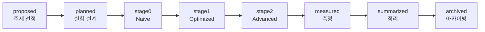

# PerfLab 진행 가이드

주제 하나를 처음부터 끝까지 진행하는 방법을 정리한 문서다. **사람이 읽는 기준 문서**이고, Claude가 따르는 상세 절차는 `.claude/` 아래에 있다.

| 문서 | 독자 | 내용 |
|---|---|---|
| [README](../README.md) | 처음 보는 사람 | 프로젝트 소개, 주제 목록 |
| **GUIDE (이 문서)** | 진행하는 사람 | 파이프라인, 역할, 명령어, 측정 해석 |
| [CONVENTIONS](CONVENTIONS.md) | 코드를 쓰고 읽는 사람 | 포맷, 이름, 주석, Stage 파일 구조 |
| [COMMITS](COMMITS.md) | 커밋하는 사람 | 커밋 제목과 본문 형식, 설정 변경 기록법, 브랜치와 머지 |
| `CLAUDE.md`, `.claude/` | Claude | 단계별 절차(skill), 규칙, 리뷰와 검증 에이전트 |

---

## 1. 한눈에 보기



- `topic.json`의 `status`는 **마지막으로 끝낸 단계**를 뜻한다. `stage1`은 "Stage 1 구현까지 끝났다"는 의미다.
- 상태는 `scripts/perflab advance`로만 바꾼다. advance는 다음 단계의 완료 조건을 검사하고, 통과해야만 전환한다.
- 한 번에 한 단계씩 진행한다. 단계가 끝나면 Claude가 보고하고 멈추며, "계속"이라고 하면 다음 단계로 간다.

## 2. 역할 분담

| | 나 (사람) | Claude |
|---|---|---|
| 하는 일 | 예측, 질문, 결정, 이해 확인 | 설계, 구현, 측정, 문서 작성 |
| 검증 | 의심스러운 코드에 질문한다 | 구현한 Claude와 분리된 에이전트가 코드와 글을 검증한다 (6절) |
| 체크포인트 | 질문에 먼저 답한다 (틀려도 괜찮다) | 답을 받기 전에는 다음 작업을 하지 않는다 |
| 기록 | — | 내 답을 원문 그대로 `docs/LEARNING.md`에 남긴다 |

체크포인트는 **설명을 듣기 전에 먼저 예측**하게 만드는 장치다. 예측과 실제의 차이가 이 프로젝트에서 가장 중요한 학습 자료다. 모르겠으면 "모르겠다"도 좋은 답이고, "스킵"하면 스킵했다고 기록한다.

질문이 너무 크면 예측할 수가 없다. 그래서 Claude는 한 질문에 한 가지만 묻고, 답에 필요한 사실을 먼저 주고, 어려운 질문은 선택지를 준다. "모르겠다"고 답하면 더 작은 질문이나 선택지로 한 번 더 묻는다.

## 3. 단계별 진행

Claude Code에서 `/perflab`을 실행하면 현재 상태에 맞는 단계를 이어서 진행한다. `/perflab new`는 새 주제, `/perflab status`는 상태 확인이다.

| 단계 | 내가 하는 일 | Claude가 하는 일 | 산출물 | 완료 조건 (advance가 검사) |
|---|---|---|---|---|
| **proposed** | 후보 3개 중 하나 고르기 | 후보 제안, `perflab new`로 주제 폴더 생성 | `topic.json` | 메타데이터, 패키지와 카탈로그 등록 |
| **planned** | ① 병목 예측, 내가 만든다면 어떻게 만들지 ② 계획 승인 | 시나리오, 지표, Stage 전략과 대가 지표 설계 | `docs/PLAN.md`, `Scenario.swift` | PLAN과 Scenario에 TODO 없음, 대가마다 지표 있음, LEARNING `[Plan]` |
| **stage0~2** | ① 이 전략이 왜 빠를지, 대가는 무엇인지 예측 ② 핵심 변경 이해 확인, 시뮬레이터에서 HUD 보기 | UIKit과 SwiftUI 구현, 정합성 테스트, 공정성 리뷰, 코드 검증 | `UIKit/`, `SwiftUI/`, `Tests/`, `docs/VERIFICATION.md` | 마커 제거, 머리말(`// 전략:`), lint 통과, LEARNING `[Stage N]`, VERIFICATION `[Stage N]`에 미해결 항목 없음, 검증 뒤 코드 변경 없음 |
| **measured** | ① 결과 보기 전 수치 예측 ② 예측과 다른 이유 함께 추론 | Release 자동 측정, 결과표, 대가 비교, 분석 | `results/`, `docs/RESULTS.md` | 한 기기에서 모든 조합과 baseline 결과, 모든 Stage에 대가 지표, LEARNING `[Measure]` |
| **summarized** | ① 뺄 것, 풀어 쓸 개념, 넣을 그림 확인 ② 초안 리뷰, "한 문장으로 설명하면?" | 블로그용 글과 그림 작성, 글 검토 | `docs/SUMMARY.md`, `docs/assets/` | TODO 없음, VERIFICATION `[Summary]`에 미해결 항목 없음, 차트가 결과 JSON과 같음, 글이 가리키는 이미지가 있음 |
| **archived** | 회고: 파이프라인에서 바꾸고 싶은 점 | README 표 갱신 | README | README에 등록 |

주제 하나는 `topic/<NN>-<slug>` 브랜치 하나에서 진행한다. 각 단계가 끝날 때 Claude가 커밋할지 묻고, archived까지 끝나면 GitHub PR로 `main`에 머지할지 묻는다 (주제가 아닌 작은 수정 브랜치는 PR 없이 로컬에서 머지한다). 커밋 메시지는 `[#NN] <status>: <요약>` 형식이고, 본문과 머지 규칙은 [COMMITS](COMMITS.md)를 따른다.

### 최적화의 범위

최적화는 CoreGraphics나 Metal 같은 저수준 API만 뜻하지 않는다. **비용이 어디서 생기는지 알고, 그 비용을 줄이도록 바꾸는 것** 전부가 최적화다.

| Stage | 기준 | 예 |
|---|---|---|
| Stage 1 · Optimized | 병목을 알면 바로 떠올리는 **관용적인 처방** | 셀 재사용, 캐싱, 무거운 작업을 메인 스레드 밖으로, diff 적용 |
| Stage 2 · Advanced | 비용이 **왜** 생기는지까지 내려가 **다시 설계**한 처방 | 아래 축 중 Stage 1이 건드리지 않은 근본 원인 |

| 축 | 다루는 질문 | 예 |
|---|---|---|
| 자료구조와 알고리즘 | 연산 횟수와 복잡도가 적절한가 | O(n²) 탐색을 딕셔너리로, 정렬 유지 삽입, 증분 계산 |
| 값 타입과 참조 타입 | 복사, 참조 카운팅(ARC), 동적 디스패치 비용 | `class` → `struct`(ARC 제거), 큰 `struct` → `class`(복사 제거), copy-on-write, `final` |
| 메모리 | 할당 횟수, 크기, 수명 | 버퍼 재사용, 다운샘플링, `autoreleasepool`, 연속 메모리 배치 |
| 동시성 | 어느 스레드에서, 얼마나 잘게, 얼마나 기다리며 | 메인 스레드 분리, actor 경합 줄이기, 작업 단위 조절, 취소, 우선순위 |
| 구조 | 변경이 얼마나 넓게 퍼지는가 | 상태 범위 좁히기, SwiftUI 무효화 범위 줄이기, 뷰 계층 평탄화, 배치 갱신 |
| 렌더링 | GPU와 렌더 서버가 하는 일 | 오프스크린 렌더링 제거, 레이어 합성, CoreGraphics, CoreAnimation, Metal |
| I/O | 읽고 쓰는 양과 시점 | 일괄 처리, 스트리밍, 지연 로딩 |

- PLAN.md의 Stage 전략에는 **어느 축의 어떤 CS 개념**을 쓰는지 적는다.
- 최적화는 대가가 있다. `struct`가 항상 빠른 것도, 동시성이 항상 빠른 것도 아니다. 예상과 다르게 느려지는 경우도 측정해 기록할 가치가 있다.
- **잴 수 있는 대가는 반드시 측정 지표에 넣는다.** PLAN.md Stage 전략 표의 "대가 지표" 열에 지표 이름을 쓰고, 결과에서 Stage끼리 비교한다.
  예) 인덱스나 캐시를 추가했다면 그 메모리를 커스텀 지표로 기록한다. 그 구조가 없는 Stage는 0을 기록한다.
- 주제마다 Stage 2의 축이 한쪽(예: 렌더링)에만 몰리지 않게 고른다.

### 카테고리 고르기

카테고리는 주제가 앱 탭 중 어디에 놓이는지를 정한다. 위의 축(어떻게 푸는가)과 달리 **병목이 어디서 생기는가**로 고른다.

| 카테고리 | 병목이 생기는 곳 |
|---|---|
| Rendering | GPU와 렌더 서버의 드로잉, 합성, 이미지 디코딩 |
| Animation | 애니메이션 프레임 처리, CoreAnimation |
| Concurrency | 스레드 배치, 대기, 경합, 취소 |
| Memory | 할당, 수명, 메모리 사용량, 값/참조 타입 |
| Algorithms | **연산량(시간·공간 복잡도) 자체.** 스레드를 옮기거나 렌더링을 바꿔도 남는 비용 |

- 둘 이상에 걸치면 **Stage 0의 병목을 없애는 데 가장 중요한 처방**이 속한 쪽을 고른다.
  예) 검색이 메인 스레드를 막는 것이 핵심이면 Concurrency, 선형 탐색을 자료구조로 바꾸는 것이 핵심이면 Algorithms.
- Algorithms 주제도 **실제 앱 화면의 문제**로 잡는다. 자료구조만 따로 재는 벤치마크로 끝내지 않고, 공통 지표(FPS, Hitch, CPU)에
  더해 연산당 시간이나 비교 횟수 같은 주제별 지표를 기록한다.
- Stack, Queue처럼 기본 자료구조만으로 끝나는 주제보다, 실제 서비스에서 쓰는 구조(예: Fenwick tree, diff 알고리즘, LRU cache,
  공간 인덱스, heap, interval tree, Bloom filter, rope)를 고른다.

## 4. 명령어

```bash
# 상태
scripts/perflab status                    # 전체 주제와 다음 단계
scripts/perflab validate <topic>          # 현재 상태 조건 검사
scripts/perflab advance <topic>           # 다음 상태로 전환 (조건 통과 시)

# 개발
scripts/perflab build                     # 앱 빌드 (기본 시뮬레이터)
scripts/perflab test <topic>              # 주제 단위 테스트
scripts/perflab format [경로...]          # swift-format 자동 정리
scripts/perflab lint [경로...]            # swift-format 검사

# 측정
scripts/perflab devices                   # 기기 목록
scripts/perflab measure <topic> [--device "<실기기>"] [--repeat 3]
scripts/perflab table <topic>             # RESULTS.md 결과표 생성

# 검증과 정리
scripts/perflab fingerprint <topic>       # 주제 코드의 지문 (VERIFICATION.md에 기록)
scripts/perflab chart <topic> --metric <이름> [--device <results 폴더>]   # 결과 JSON으로 차트(SVG+PNG) 생성
scripts/perflab png <topic>               # docs/assets/의 SVG를 PNG로 변환 (블로그 업로드용)

# 아카이빙
scripts/perflab readme                    # README Topics 표 갱신
```

`<topic>`은 id(`01-image-feed-scroll`)나 번호(`01`, `1`)로 쓴다.

## 5. 측정 방식과 지표 해석

### 측정 절차

`scripts/perflab measure`는 UI 테스트로 앱을 조합마다 새로 실행해 측정한다.

1. Release 빌드로 실행한다.
2. 앱 실행 → warm-up 2초 → 10초 녹화 → 앱 종료. 측정 중에는 HUD를 숨긴다.
3. 한 회차에 **Baseline → 모든 Stage×Framework**를 한 번씩 돌린다. 이것을 기본 3회 반복하고 지표별 **중앙값**을 쓴다.
   - 회차 단위로 섞어 돌리는 이유: 기기 발열처럼 시간이 지나며 생기는 변화가 특정 조합에만 몰리지 않게 하기 위해서다.
   - 회차별 원본은 결과 JSON의 `runs`에 남는다. 편차가 20%를 넘는 지표는 측정 중에 경고로 출력된다.
4. Stage 구현이 끝나지 않은 주제는 측정하지 않는다. 파이프라인 점검용으로만 `--allow-incomplete`를 쓴다.

조합 6개와 baseline을 3회씩 측정하면 대략 5~6분 걸린다.

### Baseline

부하가 없는 빈 화면을 Stage와 같은 조건에서 측정한 값이다. 측정 환경 자체가 만드는 노이즈(실행 직후의 시스템 작업, 시뮬레이터 지터 등)의 **바닥값**이다. Stage 간 차이가 Baseline 수준이라면 의미 있는 차이로 보지 않는다.

### 지표

| 지표 | 수집 방법 | 의미와 한계 |
|---|---|---|
| FPS avg / min | `CADisplayLink` 콜백 횟수를 0.5초 구간마다 집계 | **메인 스레드가 매 프레임을 제때 처리했는가.** min은 가장 나빴던 0.5초 구간이다. display link를 기기 최대 주사율(ProMotion 120Hz)로 요청한다. |
| Hitch count / ratio | 프레임 간격이 기대치의 1.5배를 넘으면 hitch로 센다. ratio는 초당 밀린 시간(ms/s) | Apple의 Hitch Time Ratio와 같은 개념이다. **렌더 서버(GPU) 단계의 hitch는 잡히지 않는다.** 필요하면 Instruments의 Animation Hitches로 확인한다. |
| CPU avg / peak (%) | `getrusage`로 구한 프로세스 CPU 시간의 구간 차이 ÷ 경과 시간 | 100% = 코어 1개를 완전히 사용. 측정 구간에 끝난 스레드도 포함한다. |
| Memory avg / peak (MB) | `task_info(TASK_VM_INFO).phys_footprint` | Xcode Memory Gauge, Jetsam과 같은 기준이다. |
| Threads peak | `task_threads` | 샘플링 시점의 스레드 수라서, 순간적으로 생겼다 사라진 스레드는 놓칠 수 있다. |
| 주제별 지표 | `context.metrics` | 주제마다 PLAN.md에 정의한다. |

측정 코드 자체의 비용은 0.5초마다 수 µs 수준이라 결과에 영향을 주지 않는다.

### 시뮬레이터와 실기기

정식 결과는 **실기기 + Release**다. 시뮬레이터는 Mac CPU와 GPU를 쓰기 때문에 수치는 참고용이며, 결과표에 그렇게 표시된다.

- **실기기가 가능하면 처음부터 실기기로 잰다.** 시뮬레이터로 먼저 재고 분석을 쓰면, 실기기 결과가 나왔을 때 다시 써야 한다.
- 시뮬레이터 수치는 Mac의 상태와 런타임 버전에 따라 크게 달라진다. #01에서는 같은 코드의 한 지표가 사흘 간격으로 13%와 54%가 나왔다. 서로 다른 날의 시뮬레이터 값끼리도 비교하지 않는다.
- 측정은 검증받은 코드로만 한다 (6절). 측정 뒤에 주제 코드를 고치면 다시 검증받고 다시 측정한다.

## 6. 검증과 정리

구현도 설명도 Claude가 하므로, **틀린 설명이 그럴듯하게 들릴 수 있다.** 그래서 구현한 Claude와 분리된 에이전트가 코드와 글을 따로 검증하고, 그 기록이 없으면 다음 단계로 넘어가지 못하게 한다.

### 코드 검증 (`code-verifier`)

Stage 구현 직후, 사용자에게 설명하기 **전에** 실행한다. 구현 의도는 전달받지 않고 코드와 문서만 본다.

```
구현 → format/test/build → stage-reviewer(공정성) → code-verifier(코드 검증) → 조치 → 구현 후 체크포인트 → advance
```

코드와 주석이 하는 주장을 하나씩 꺼내 판정한다: 주석의 사실 주장, 머리말(`// 전략:`, `// 변경:`)과 코드의 일치, API가 말한 대로 동작하는지, 각 코드가 왜 필요한지, 개선 주장의 근거, 지표 기록이 PLAN.md 정의와 같은지.

| 판정 | 뜻 | 다음 |
|---|---|---|
| ✅ 검증됨 | 테스트, 측정, 실험, 공식 문서, 코드 중 하나로 확인했다 | - |
| ⚠️ 추정 | 그럴듯하지만 확인하지 못했다 | 실험으로 확인하거나, 단정을 빼거나, "추정"이라고 밝힌다 |
| ❌ 틀림 | 근거와 어긋난다 | 고치거나 지운다 |

- 결과는 `docs/VERIFICATION.md`에 Stage마다 남는다. 판정은 고치지 않고 `조치` 열에 무엇을 했는지 적는다. 무엇이 불확실했는지가 기록으로 남는다.
- **검증받은 코드와 지금 코드가 같아야 한다.** 검증이 끝나면 코드의 지문(`scripts/perflab fingerprint`)을 적어 두고, `advance`는 그 지문이 지금 코드와 다르면 실패한다. 코드를 고쳤으면 다시 검증받는다.
- 내가 코드에 의문이 생기면 언제든 묻는다. 그 문답도 LEARNING.md에 남고, 코드가 바뀌면 다시 검증된다.

### 글과 그림 (`summary-reviewer`)

SUMMARY.md는 블로그에 올리는 글이다. 세 가지를 지킨다.

1. **줄인다.** 독자가 얻어 갈 것 2~3가지에 쓰이지 않는 내용(진행 과정, 곁가지 지표, 전체 표)은 빼고 링크로 대신한다.
2. **핵심은 풀어 쓴다.** 핵심 개념 2~3개는 비유로 설명하고, 비유마다 어디서 어긋나는지 한 줄을 붙인다.
3. **그림은 정확할 때만 넣는다.** 글보다 빨리 이해되는 것만, 글 하나에 3~5개까지.

| 그림 | 만드는 법 | 틀리지 않게 하는 장치 |
|---|---|---|
| 차트 | `scripts/perflab chart <topic> --metric <이름>` | 결과 JSON에서 바로 그린다. 숫자를 옮겨 적는 단계가 없고, 결과와 달라지면 `advance`가 실패한다. 차트 하나에 지표 하나, 축은 0부터 |
| 다이어그램 | `docs/assets/diagram-<이름>.svg`를 쓰고 `scripts/perflab png` | 상자 7개 안팎, 실제 코드의 타입과 호출 순서만, 수치는 적지 않는다. `summary-reviewer`가 코드와 대조한다 |
| 화면 캡처 | 앱의 실제 화면 | 꾸미거나 합성하지 않는다 |

- 글을 쓰기 전에 Claude가 "뺄 것, 풀어 쓸 것, 넣을 그림" 목록을 먼저 보여 준다. 여기서 방향을 정한다.
- 초안이 나오면 `summary-reviewer`가 글의 모든 수치를 결과 JSON과, 다이어그램과 코드 인용을 실제 코드와 대조한다. 가설을 사실처럼 쓴 문장도 잡는다.
- 블로그(Tistory)는 Mermaid와 SVG를 그리지 못한다. 글에는 PNG를 넣고, 올릴 때 `docs/assets/`의 PNG를 함께 업로드한다.

## 7. 처음 준비

- Xcode 26 이상, iOS 26 시뮬레이터 (`scripts/perflab build`가 iPhone 17 Pro를 자동으로 찾는다)
- 실기기 측정 (measure 단계 전까지 준비):
  1. 기기를 연결하고 Xcode의 Devices 창에서 페어링한다.
  2. PerfLab 타깃과 PerfLabUITests 타깃의 Signing에서 Team을 지정한다.
  3. `scripts/perflab devices`에 기기 이름이 나오는지 확인한다.

## 8. 막혔을 때

| 상황 | 해결 |
|---|---|
| `advance`가 실패한다 | 출력된 미충족 항목을 해결한다. 검사를 우회하거나 `topic.json`을 직접 고치지 않는다. |
| lint 위반 | `scripts/perflab format <주제 경로>`로 자동 수정한다. |
| 측정 결과의 편차가 크다 | 기기 발열, 저전력 모드, 백그라운드 앱을 확인하고 다시 측정한다. 재측정한 사실은 RESULTS.md에 기록한다. |
| `advance`가 "검증 뒤에 코드가 바뀜"으로 실패한다 | 바뀐 코드를 `code-verifier`로 다시 검증받고 새 지문을 적는다. 지문만 고쳐 적지 않는다. |
| 설명이 의심스럽다 | 근거를 묻는다. 근거가 테스트, 측정, 실험, 공식 문서가 아니면 "추정"이다. |
| 계획이 구현과 맞지 않는다 | 구현을 멈추고 PLAN.md 수정을 논의한다. 계획을 몰래 바꾸지 않는다. |
| Shared를 고쳐야 할 것 같다 | 모든 주제에 쓸 수 있는 일반적인 기능인지 먼저 따진다. Claude는 고치기 전에 알린다. |
